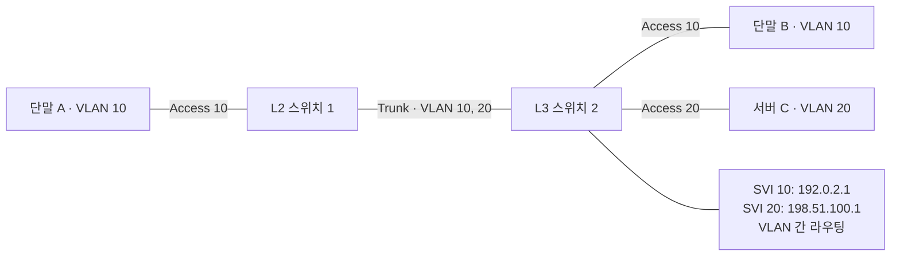

# VLAN → Trunk → VLAN 간 라우팅

실무 네트워크 구성도를 볼 때 **단말의 소속 → 스위치 사이 운반 → 다른 망으로 나가는 지점** 순으로 읽는다. 아래는 원본의 개념을 설명하기 위한 구성 예시이며 실제 사내망이나 장비에서 검증한 구성이 아니다.

## 예시 구성

| 대상 | 소속 | IPv4 / 기본 게이트웨이 |
| --- | --- | --- |
| 단말 A | VLAN 10 | `192.0.2.10/24` / `192.0.2.1` |
| 단말 B | VLAN 10 | `192.0.2.20/24` / `192.0.2.1` |
| 서버 C | VLAN 20 | `198.51.100.20/24` / `198.51.100.1` |

주소는 설명용이며, IP 라우팅을 활성화한 L3 스위치가 두 VLAN의 게이트웨이를 제공한다고 가정한다. **SVI(Switched Virtual Interface)**는 VLAN에 연결된 논리적인 L3 인터페이스다. SVI를 만들기만 하면 모든 장비에서 자동으로 라우팅되는 것은 아니며, 기능 지원·활성 상태·라우팅 설정이 필요하다.

그림의 SVI는 스위치 2 내부의 논리 인터페이스이며 별도 장비가 아니다.

## A → B: 같은 VLAN·같은 서브넷

1. A는 B를 로컬 서브넷의 목적지로 판단한다.
2. ARP 캐시에 B의 MAC이 없으면 VLAN 10에 ARP 요청을 보낸다.
3. 스위치 1은 VLAN 10 범위로 전달한다. Trunk 구간에서는 VLAN 10 소속을 유지해 운반한다.
4. 스위치 2의 VLAN 10 access 포트를 통해 B에게 도달한다. VLAN 20의 C에게는 이 브로드캐스트를 보내지 않는다.
5. B의 MAC을 알게 된 A는 B를 목적 MAC으로 통신한다. 이 경로에서는 기본 게이트웨이가 라우팅하지 않는다.

## A → C: 다른 VLAN·다른 서브넷

1. A는 C가 다른 서브넷에 있으므로 기본 게이트웨이 `192.0.2.1`로 보낸다.
2. A가 ARP로 알아내는 대상은 **C가 아니라 게이트웨이의 MAC**이다. 첫 프레임의 목적 MAC은 게이트웨이, 내부 IP 패킷의 목적 주소는 C다.
3. VLAN 10을 통해 프레임을 받은 L3 스위치는 라우팅 테이블과 적용된 접근 정책을 확인한다.
4. C가 연결된 VLAN 20으로 전달할 때 C의 MAC을 확인하고, 그 링크에 맞는 새 이더넷 프레임을 만든다. NAT 없는 이 예시에서는 출발지·목적지 IP는 유지되고 TTL은 감소한다.
5. C의 응답도 다른 서브넷의 A로 돌아가려면 게이트웨이와 반환 경로가 필요하다.

핵심은 trunk에서 VLAN ID를 바꿔 보내는 것이 아니라, **L3 경계에서 IP 패킷을 다음 링크의 프레임에 실어 전달한다**는 점이다 → [[ip-routing]]·[[network-encapsulation]]. L3 스위치 대신 외부 라우터의 VLAN별 서브인터페이스를 이용하는 구성도 가능하다. [Cisco VLAN 간 라우팅](https://www.cisco.com/c/en/us/support/docs/lan-switching/inter-vlan-routing/41260-189.html), [외부 라우터 구성](https://www.cisco.com/c/en/us/support/docs/lan-switching/inter-vlan-routing/14976-50.html)

## 통신이 안 될 때 확인할 순서

| 증상 | 확인할 내용 | 이유 |
| --- | --- | --- |
| 같은 VLAN인데 다른 스위치의 단말만 안 됨 | 양쪽 VLAN 존재, access 소속, trunk 허용 목록·상태, native VLAN 일치 | 중간 링크에서 VLAN이 끊길 수 있음 |
| 같은 VLAN은 되지만 다른 VLAN은 안 됨 | 단말 마스크·게이트웨이, SVI 상태, 라우팅, ACL·방화벽, 반환 경로 | L2 전달 성공이 L3 전달 성공을 뜻하지 않음 |
| IP를 자동으로 받지 못함 | 해당 VLAN의 DHCP 서버 또는 DHCP relay, 주소 풀, 접근 정책 | 초기 DHCP 브로드캐스트는 라우터를 자동으로 넘어가지 않음 |
| IP로는 되지만 이름으로 안 됨 | DNS 서버 설정과 도달 가능성, 이름 레코드 | 이름 해석과 주소 할당은 다른 기능 |
| 통신은 되지만 특정 시간에 느림 | uplink 사용량·손실, 복제·백업·VM 이동 트래픽 | VLAN이 분리돼도 물리 대역폭을 공유할 수 있음 |

DHCP 서버가 다른 서브넷에 있으면 relay가 클라이언트의 요청을 서버에 전달할 수 있다. **DNS는 DHCP의 대체 서버가 아니다.** [Cisco DHCP 문서](https://www.cisco.com/c/en/us/support/docs/ip/dynamic-address-allocation-resolution/27470-100.html), [DNS 개념 — RFC 1034](https://www.rfc-editor.org/rfc/rfc1034.html)

`ping`만으로 앱의 정상 동작까지 판정하지 않는다. IP 경로가 확인되면 [[network-timeout]]에서 TCP 포트·연결·응답 대기 단계로 좁힌다. 가상화 호스트의 uplink까지 포함하면 [[network-virtualization]]과 연결된다.

출처 요약: [[vlan-wikipedia-article]]. 개념부터 다시 보려면 [[vlan]].
